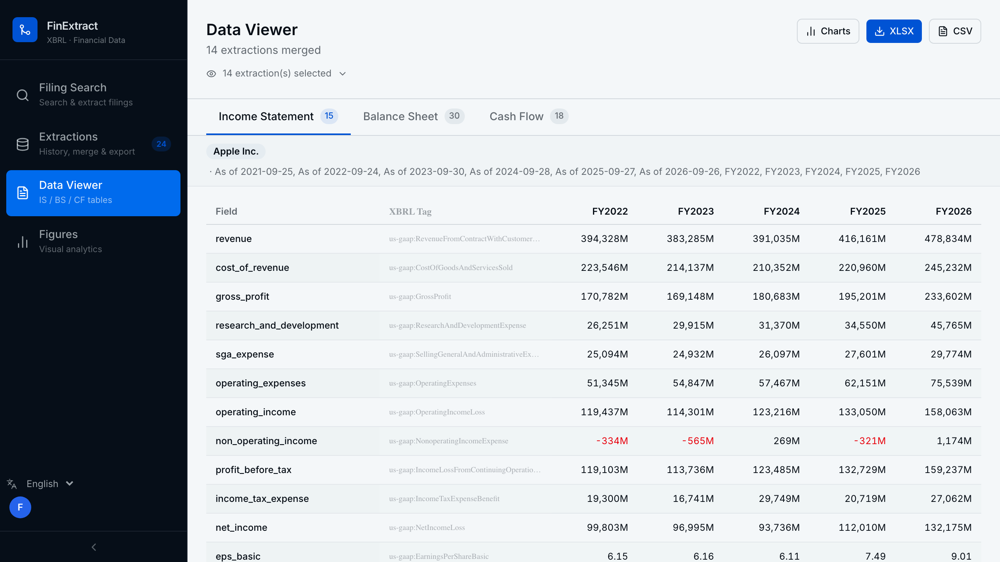
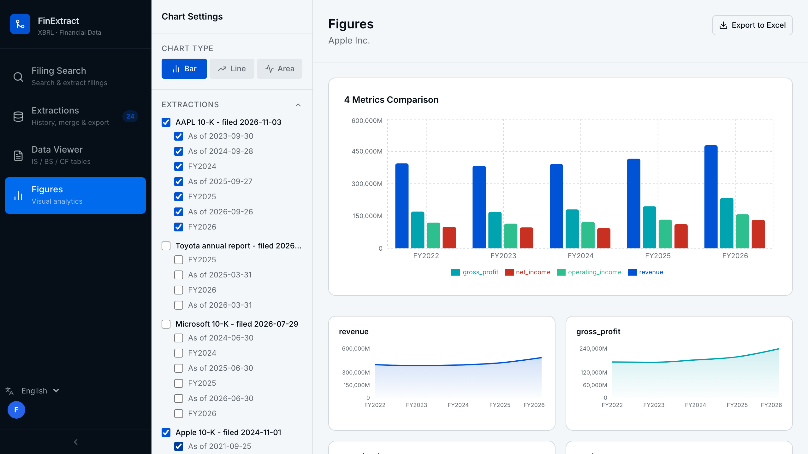
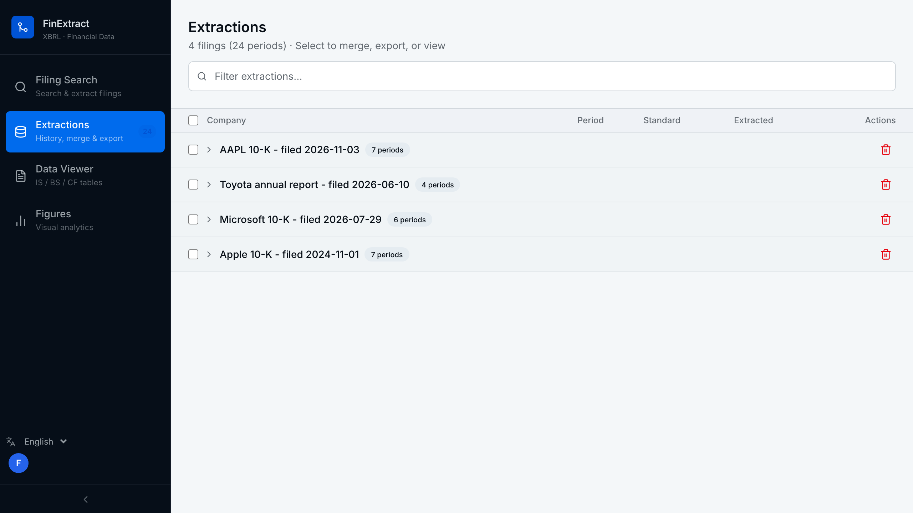
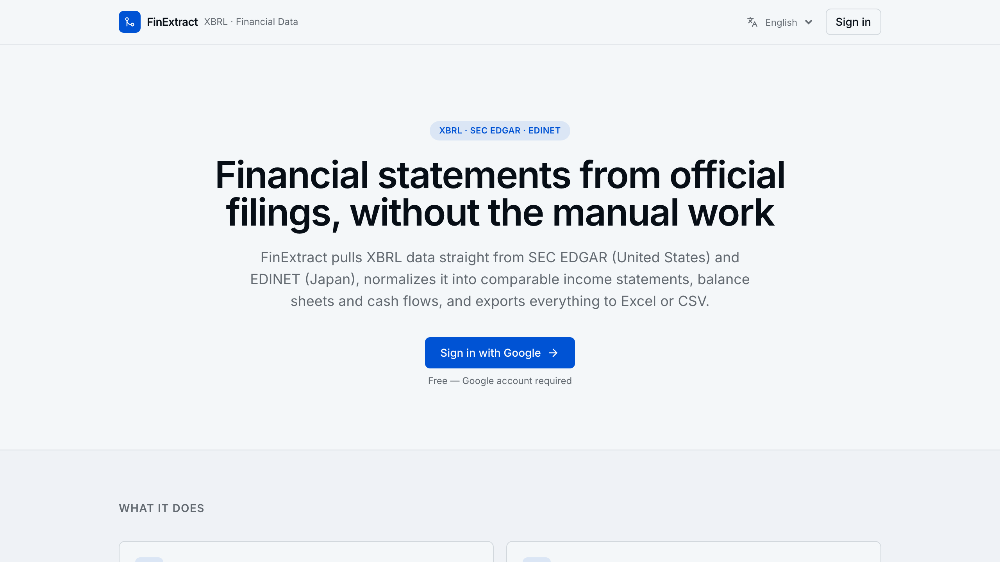

# FinExtract

Financial statements from official company filings, without copying numbers out of a PDF by hand.

**Try it: [finextract.dmathieu.dev](https://finextract.dmathieu.dev)**


Search a company, pick a filing, and FinExtract reads its XBRL data straight from the regulator. Income statement, balance sheet and cash flow come out in one common schema, ready for Excel, CSV or JSON.

## Features

- Official sources: SEC EDGAR (US) and EDINET (Japan), or upload your own XBRL/iXBRL file
- One standard field set across US GAAP, Japanese GAAP and IFRS tags (`us-gaap:Revenues`, `jppfs_cor:NetSales`, ... become `revenue`)
- Merge several filings into one multi-year view, with the original XBRL tag kept next to each value
- Charts: bar, line and area, across any metrics and periods
- Export to CSV or a styled Excel workbook (income statement, balance sheet and cash flow sheets, optional native chart sheet)
- Saved extraction history, private to your account
- English, French and Japanese interface

## Screenshots

| Multi-year statements              | Charts                               |
| ---------------------------------- | ------------------------------------ |
|     |          |

| Extraction history                      | Landing page                     |
| --------------------------------------- | -------------------------------- |
|     |      |

## Getting started

Requires Docker, a free [Clerk](https://clerk.com) dev instance, and optionally a free [EDINET API key](https://api.edinet-fsa.go.jp/api/auth/index.aspx?mode=1).

```bash
cp .env.example .env   # fill in the Clerk keys and your SEC User-Agent
docker compose up --build
```

Then open http://localhost:3000. API docs are at http://localhost:8000/docs.

## Commands

| Command                                 | What it does                   |
| --------------------------------------- | ------------------------------ |
| `uv sync`                               | Install the backend            |
| `uv run pytest`                         | Run the tests                  |
| `uv run ruff check .`                   | Lint                           |
| `uv run ruff format .`                  | Format                         |
| `uv run uvicorn finextract.main:app --reload` | Start the API            |
| `pnpm dev` (in `frontend/`)             | Start the frontend             |
| `pnpm typecheck` (in `frontend/`)       | Type-check with tsc            |
| `pnpm build` (in `frontend/`)           | Production build               |

## How it works

1. **Extract**: fetch a filing's raw XBRL facts from SEC EDGAR, EDINET or an uploaded file.
2. **Map**: translate filer-specific tags into the standard field set with a static tag table. Dimensional facts (revenue by product line, for example) are left out, so only consolidated totals reach the statement.
3. **Export**: serve the statement as JSON, CSV or Excel, and save it to Postgres as extraction history.

```
src/finextract/
├── shared_kernel/    # cross-context value objects (Currency, FiscalPeriod, ReportingStandard)
├── extraction/       # get raw XBRL facts from a filing
├── mapping/          # normalize raw facts into the standard schema
├── export/           # write the standard schema to CSV/Excel/Postgres
└── interfaces/http/  # FastAPI routes
```

Each context is split into `domain/` (entities and ports, no framework imports), `application/` (use cases) and `infrastructure/` (adapters). `frontend/` is a separate Next.js app.

## Stack

FastAPI, SQLAlchemy, Alembic, lxml, pandas and openpyxl on the backend. Next.js, Tailwind CSS v4, shadcn/ui and Recharts on the frontend. Clerk for auth, Postgres (Neon) for history, GCP Cloud Run provisioned with OpenTofu.

## Known gaps

- XBRL only: no PDF or OCR extraction.
- The tag map is applied at extraction time, so re-extract a filing to benefit from a tag map update.
- SEC EDGAR only covers 10-K, 10-Q, 20-F and 40-F forms.

## Contributing

Issues and pull requests are welcome: see [CONTRIBUTING.md](.github/CONTRIBUTING.md). Security reports go through [SECURITY.md](.github/SECURITY.md).

Commits follow [Conventional Commits](https://www.conventionalcommits.org) (`feat:`, `fix:`, `chore:`, ...), checked by a pre-commit hook and in CI.

CI runs the dependency audits, ruff, pytest, typecheck and the frontend build. Releases are created by running the **Create Release** workflow by hand: it runs CI, tags a CalVer version (`vYYYY.M.N`), writes the changelog with git-cliff, then deploys that tag to Cloud Run. Details in [`infra/README.md`](infra/README.md).

## Data sources

FinExtract is an independent project with no link to the SEC or the Japanese FSA. Check figures against the original filing before relying on them; nothing here is investment advice.

## License

[MIT](LICENSE)
